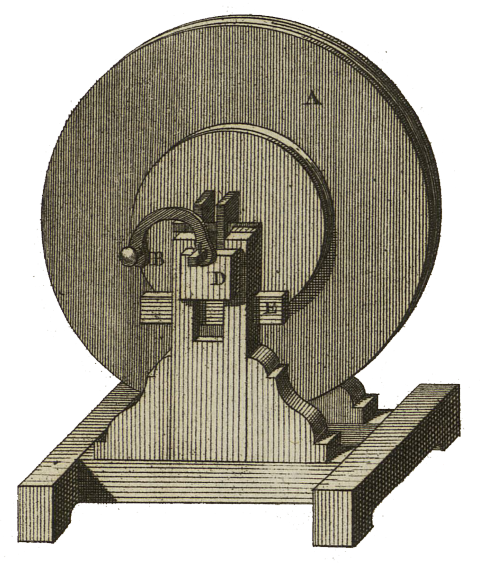
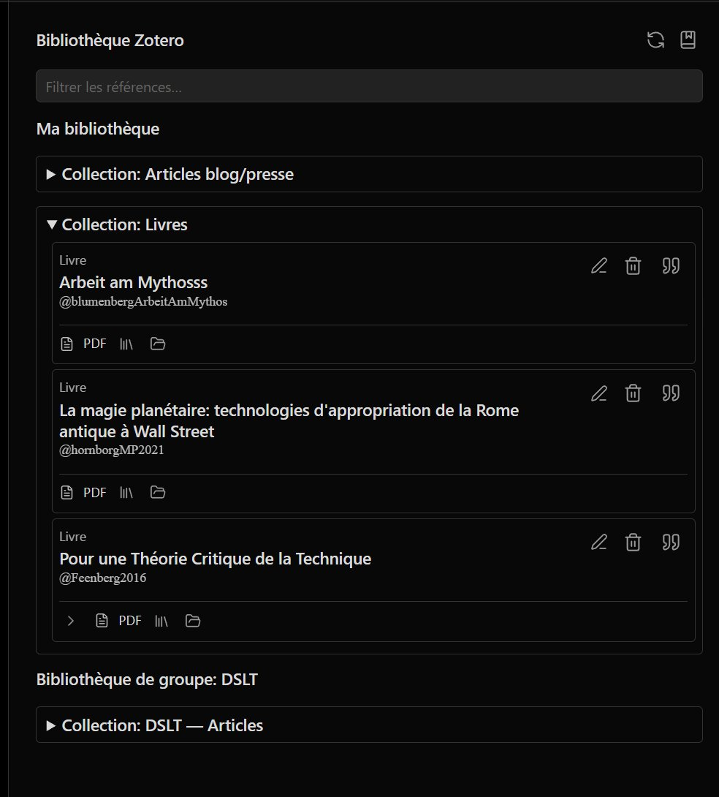
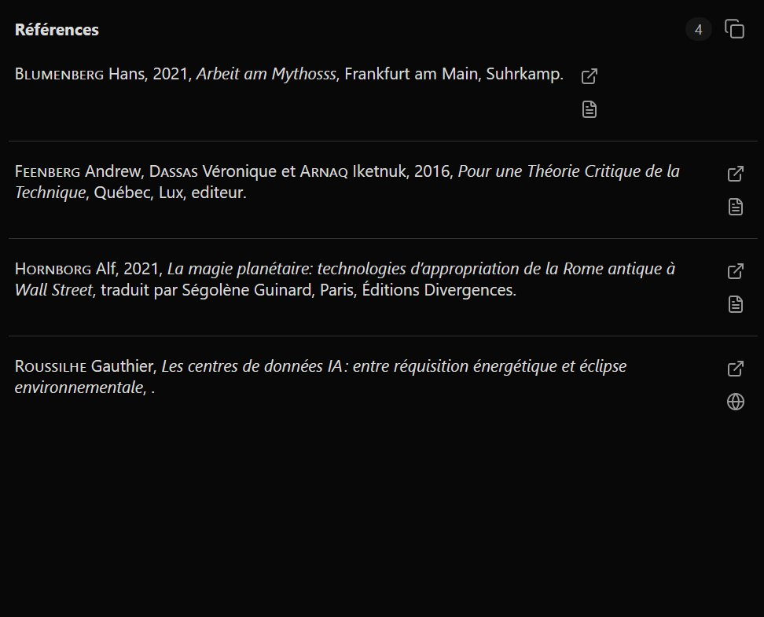

<table>
<tr>
<td></td>
<td align="left">
<h1 style="margin:0">Radiomarker</h1>

<strong>REAPER-Marker · 4-Spur-Podcast · Obsidian-Export</strong> Lua-Skripte · Windows-Installer · HTML-Oberfläche

</td>
</tr>
</table>

  
Entwickelt von <a href="https://atelier.atechnologie.fr/">l'Atelier</a> — Buchherstellung und Forschungswerkzeuge (EHESS)

🇫🇷 <a href="README.md">Français</a> ·
🇬🇧 <a href="README.en.md">English</a> ·
🇩🇪 <a href="README.de.md"><b>Deutsch</b></a> ·
🇪🇸 <a href="README.es.md">Español</a>

---

## 📸 Vorschau

| HTML-Oberfläche | Marker |
| :---: | :---: |
|  |  |

---

## 📖 Über das Projekt

Radiomarker fügt HTML-Schaltflächen hinzu, um REAPER-Marker nach Sprecher (**P1 bis P4**) und Typ (**Fehler**, **Zitat**, **Notiz**, **Benennen**) zu setzen, mit Markdown-/Audio-Export nach **Obsidian**.

---

## ⬇️ Windows-Installation (empfohlen)

1. Installer bauen: [`installer/RadiomarkerSetup.iss`](installer/RadiomarkerSetup.iss) in **Inno Setup 6** öffnen, dann *Build → Compile*. Die EXE liegt unter `dist/RadiomarkerSetup.exe`.
2. `RadiomarkerSetup.exe` starten. Den **REAPER-Ressourcenordner** angeben:
   - klassische Installation: meist `%APPDATA%\REAPER` (Standardvorschlag) ;
   - **portables REAPER**: der Datenordner dieser Kopie (wo REAPER `Scripts` liest/schreibt).
3. Der Installer kopiert Dateien nach `Scripts\Radiomarker\` und führt `Scripts\__startup.lua` zusammen, ohne eine vorhandene Datei zu überschreiben: er fügt einmal einen Block `Radiomarker bootstrap (installer)` hinzu.
4. Beim nächsten REAPER-Start werden Skripte registriert und das HTML **ohne Erfolgsfenster** synchronisiert (stiller Modus). Fehler melden sich weiterhin.
5. `podcast_4pistes.html` über die REAPER-Weboberfläche öffnen (optional: Desktop-Verknüpfung bei der Installation).

---

## 🛠️ Manuelle Installation (ohne Installer)

Projektordner (oder mindestens `reaper_lua_markers/` und `podcast_4pistes.html`) so ablegen, dass die Struktur erhalten bleibt: ein übergeordnetes Verzeichnis mit `reaper_lua_markers\` und `podcast_4pistes.html` auf derselben Ebene (wie in diesem Repo).

Dann in REAPER:

1. Aktionsliste öffnen (`?`).
2. `ReaScript: Run/edit ReaScript (EEL2 or Lua)..` ausführen und wählen:
   - zuerst `reaper_lua_markers/install_markers_actions.lua` ;
   - danach `reaper_lua_markers/sync_html_command_map.lua`.
3. Für den automatischen Start wie beim Installer in `Scripts\__startup.lua` den im Installer beschriebenen Aufruf ergänzen (Block `Radiomarker bootstrap (installer)`), oder einmal `reaper_lua_markers/radiomarker_bootstrap.lua` aus einem vorhandenen Startskript starten.

---

## 📝 Obsidian-Export (MP3 + Markdown)

**Wichtig:** Die `.md`-Datei entsteht **nicht** allein durch *File → Render*. Reihenfolge: **zuerst** *File → Render* (nach `D:\…` oder REAPER Media), **danach** die Aktion **`export_markers_obsidian`** (sie startet den Render nicht erneut).

1. **File → Project render settings** konfigurieren (MP3 oder WAV, Mixdown, Ausgabeordner).
2. REAPER-Projekt so benennen, wie es in der Notiz erscheinen soll (`audio_start_time` übernimmt diesen Namen; bei Namen `YYYY-MM-DD HH:MM:SS` enthalten Links auch absolute Zeitstempel `\[HH:MM:SS]`).
3. Marker mit der Radiomarker-Oberfläche setzen.
4. **File → Render** → MP3/WAV erzeugen.
5. **`export_markers_obsidian`** starten: das Skript liest den **RENDER_FILE**-Pfad von REAPER (auch unter `REAPER Media\…\projekt.mp3\projekt.mp3`) und schreibt die `.md` **in denselben Ordner** wie das Audio.
6. Wird nichts erkannt, erscheint ein Dialog zum **manuellen Auswählen der Audiodatei**.
7. Erzeugte Dateien:
   - `{Projektname}.mp3` (oder der beim Render gewählte Name) — gemischtes Audio ;
   - gleicher Name mit Endung `.md` — Frontmatter, Embed `![[…mp3]]`, Links `[[…mp3#t=sec|MM:SS]]` pro Marker (klickbar in Obsidian).
8. Audio und `.md` in denselben Ordner des Obsidian-Vaults legen.

Radiomarker-Marker (BENENNEN, FEHLER, ZITAT usw.) werden jeweils zu einer Linkzeile; die Beschriftung ist der Text nach dem letzten `_` im Markernamen (z. B. `Sprecher1_start` → `start`). Nach jedem Link folgt eine Leerzeile für Notizen in Obsidian.

---

## 📁 Nützliche Dateien

- `podcast_4pistes.html` — Web-Schaltflächenoberfläche
- `reaper_lua_markers/install_markers_actions.lua` — registriert Skripte in der Aktionsliste
- `reaper_lua_markers/sync_html_command_map.lua` — injiziert `Command ID`s in das HTML
- `reaper_lua_markers/radiomarker_bootstrap.lua` — verkettet Install + Sync im stillen Modus (REAPER-Start)
- `reaper_lua_markers/export_markers_obsidian.lua` — MP3- + Obsidian-Markdown-Export
- `reaper_lua_markers/radiomarker_export.lua` — gemeinsame Exportbibliothek
- `installer/RadiomarkerSetup.iss` — Inno-Setup-Skript → `dist/RadiomarkerSetup.exe`

---

## 🔗 Ressourcen

| | |
| --- | --- |
| 🌐 **l'Atelier** | [atelier.atechnologie.fr](https://atelier.atechnologie.fr/) |
| 📦 **Repository** | [github.com/Atelier-Recherche/radiomarker](https://github.com/Atelier-Recherche/radiomarker) |

---

<a href="README.md">🇫🇷 Français</a> · <a href="README.en.md">🇬🇧 English</a> · 🇩🇪 Deutsch · <a href="README.es.md">🇪🇸 Español</a> · Radiomarker — <a href="https://atelier.atechnologie.fr/">l'Atelier</a>

