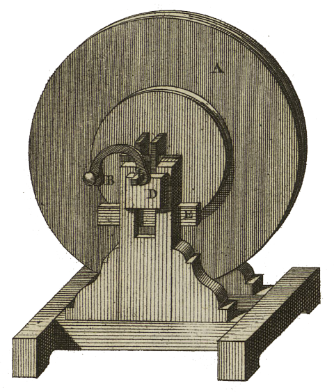
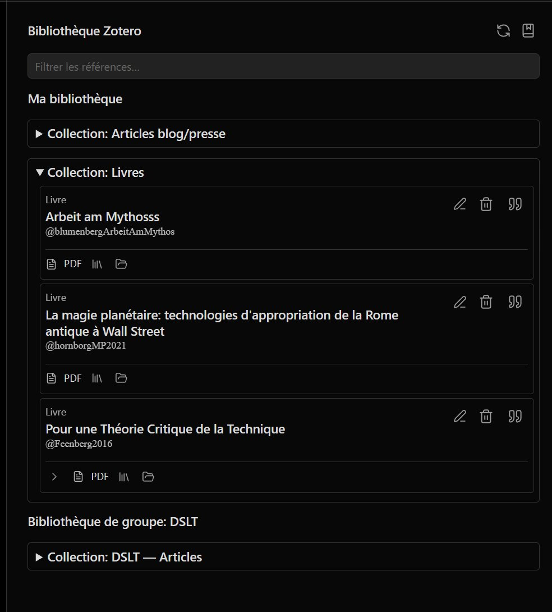
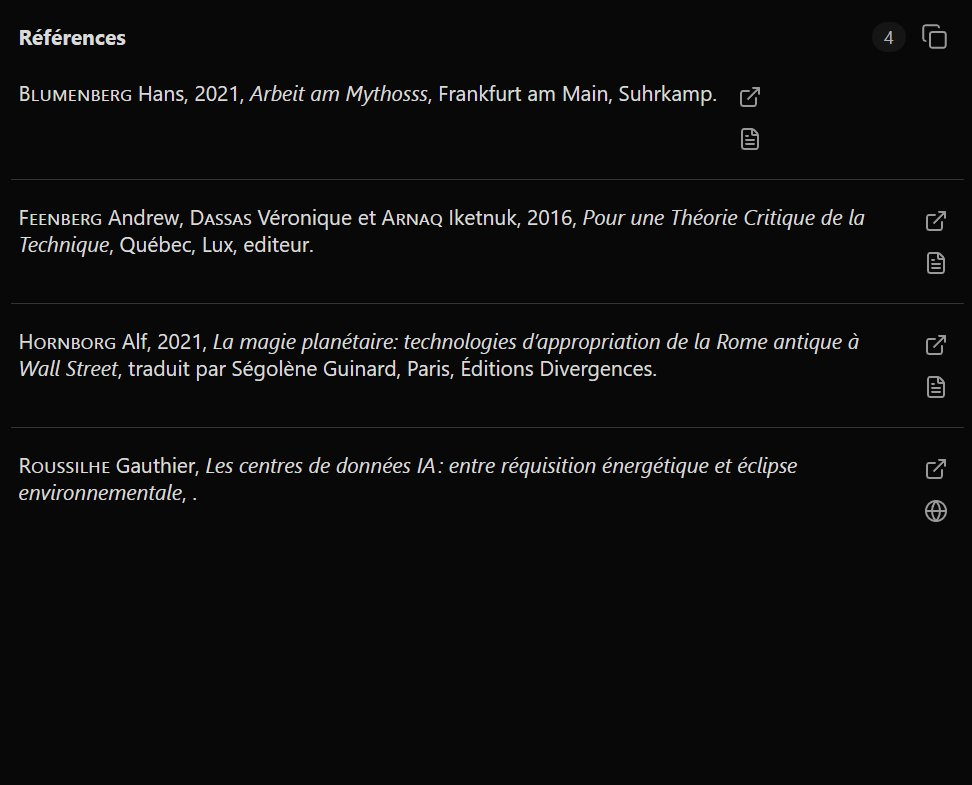

<table>
<tr>
<td></td>
<td align="left">
<h1 style="margin:0">Radiomarker</h1>

<strong>REAPER markers · 4-track podcast · Obsidian export</strong> Lua scripts · Windows installer · HTML interface

</td>
</tr>
</table>

  
Developed by <a href="https://atelier.atechnologie.fr/">l'Atelier</a> — book fabrication and research tools (EHESS)

🇫🇷 <a href="README.md">Français</a> ·
🇬🇧 <a href="README.en.md"><b>English</b></a> ·
🇩🇪 <a href="README.de.md">Deutsch</a> ·
🇪🇸 <a href="README.es.md">Español</a>

---

## 📸 Preview

| HTML interface | Markers |
| :---: | :---: |
|  |  |

---

## 📖 About

Radiomarker adds HTML buttons to place REAPER markers by speaker (**P1 to P4**) and type (**Error**, **Quote**, **Note**, **Name**), with Markdown / audio export to **Obsidian**.

---

## ⬇️ Windows installation (recommended)

1. Build the installer: open [`installer/RadiomarkerSetup.iss`](installer/RadiomarkerSetup.iss) in **Inno Setup 6**, then *Build → Compile*. The executable is written to `dist/RadiomarkerSetup.exe`.
2. Run `RadiomarkerSetup.exe`. Point to the **REAPER resource folder**:
   - classic install: usually `%APPDATA%\REAPER` (default suggestion) ;
   - **portable REAPER**: that copy’s data folder (where REAPER reads/writes `Scripts`).
3. The installer copies files under `Scripts\Radiomarker\` and merges `Scripts\__startup.lua` without overwriting an existing file: it adds a block marked `Radiomarker bootstrap (installer)` once.
4. On the next REAPER launch, scripts are registered and the HTML is synced **without success dialogs** (silent mode). Errors still show messages.
5. Open `podcast_4pistes.html` from the REAPER web interface (optional: Desktop shortcut if checked at install).

---

## 🛠️ Manual installation (no installer)

Place the project folder (or at least `reaper_lua_markers/` and `podcast_4pistes.html`) so the structure stays: a parent directory containing `reaper_lua_markers\` and `podcast_4pistes.html` at the same level (as in this repo).

Then in REAPER:

1. Open the Actions list (`?`).
2. Run `ReaScript: Run/edit ReaScript (EEL2 or Lua)..` and choose:
   - first `reaper_lua_markers/install_markers_actions.lua` ;
   - then `reaper_lua_markers/sync_html_command_map.lua`.
3. For automatic startup like the installer, add to `Scripts\__startup.lua` the call described in the installer (`Radiomarker bootstrap (installer)` block), or run once `reaper_lua_markers/radiomarker_bootstrap.lua` from an existing startup script.

---

## 📝 Obsidian export (MP3 + Markdown)

**Important:** the `.md` is **not** created by *File → Render* alone. Order: **first** *File → Render* (to `D:\…` or REAPER Media), **then** the **`export_markers_obsidian`** action (it does not re-run the render).

1. Configure **File → Project render settings** (MP3 or WAV, mixdown, output folder).
2. Name the REAPER project as you want it shown in the note (`audio_start_time` uses that name; if the name is `YYYY-MM-DD HH:MM:SS`, links also include absolute timestamps `\[HH:MM:SS]`).
3. Place markers with the Radiomarker interface.
4. **File → Render** → produce the MP3/WAV.
5. Run **`export_markers_obsidian`**: the script reads REAPER’s **RENDER_FILE** path (even if the file is under `REAPER Media\…\project.mp3\project.mp3`) and writes the `.md` **in the same folder** as the audio.
6. If nothing is detected, a dialog asks you to **pick the audio file** manually.
7. Produced files:
   - `{ProjectName}.mp3` (or the name chosen at render) — mixed audio ;
   - same name with `.md` extension — frontmatter, embed `![[…mp3]]`, links `[[…mp3#t=sec|MM:SS]]` per marker (clickable in Obsidian).
8. Put the audio and the `.md` in the **same folder** of your Obsidian vault.

Radiomarker markers (NAME, ERROR, QUOTE, etc.) each become one link line; the label is the text after the last `_` in the marker name (e.g. `Speaker1_start` → `start`). An empty line follows each link so you can add notes in Obsidian.

---

## 📁 Useful files

- `podcast_4pistes.html` — web button interface
- `reaper_lua_markers/install_markers_actions.lua` — registers scripts in the Actions list
- `reaper_lua_markers/sync_html_command_map.lua` — injects `Command ID`s into the HTML
- `reaper_lua_markers/radiomarker_bootstrap.lua` — chains install + sync silently (REAPER startup)
- `reaper_lua_markers/export_markers_obsidian.lua` — MP3 + Obsidian Markdown export
- `reaper_lua_markers/radiomarker_export.lua` — shared export library
- `installer/RadiomarkerSetup.iss` — Inno Setup script → `dist/RadiomarkerSetup.exe`

---

## 🔗 Resources

| | |
| --- | --- |
| 🌐 **l'Atelier** | [atelier.atechnologie.fr](https://atelier.atechnologie.fr/) |
| 📦 **Repository** | [github.com/Atelier-Recherche/radiomarker](https://github.com/Atelier-Recherche/radiomarker) |

---

<a href="README.md">🇫🇷 Français</a> · 🇬🇧 English · <a href="README.de.md">🇩🇪 Deutsch</a> · <a href="README.es.md">🇪🇸 Español</a> · Radiomarker — <a href="https://atelier.atechnologie.fr/">l'Atelier</a>

