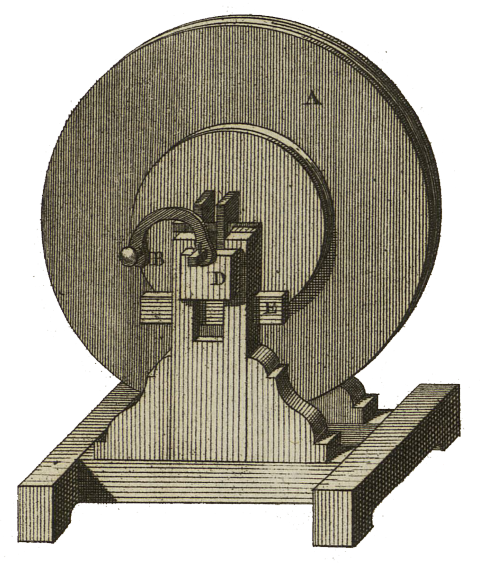
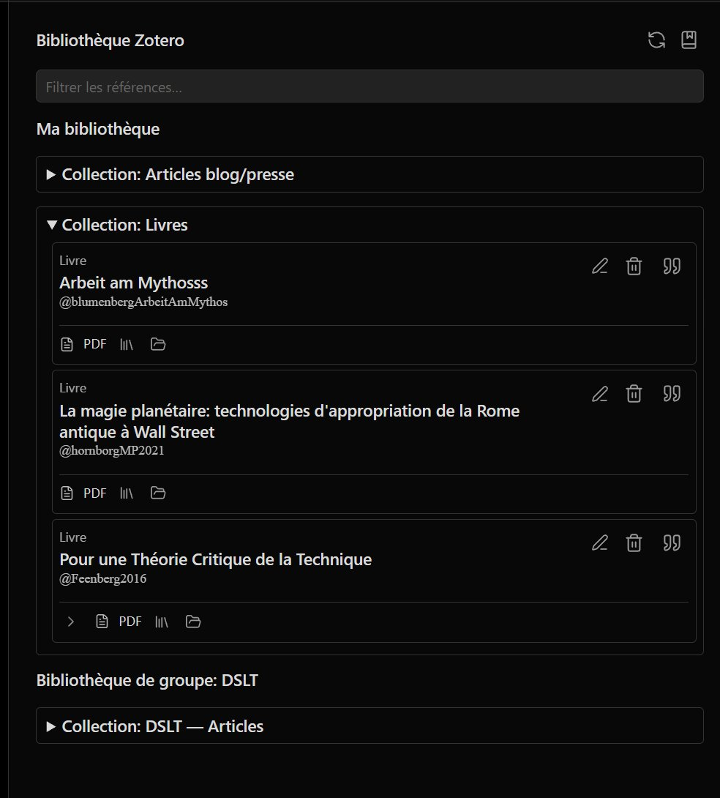
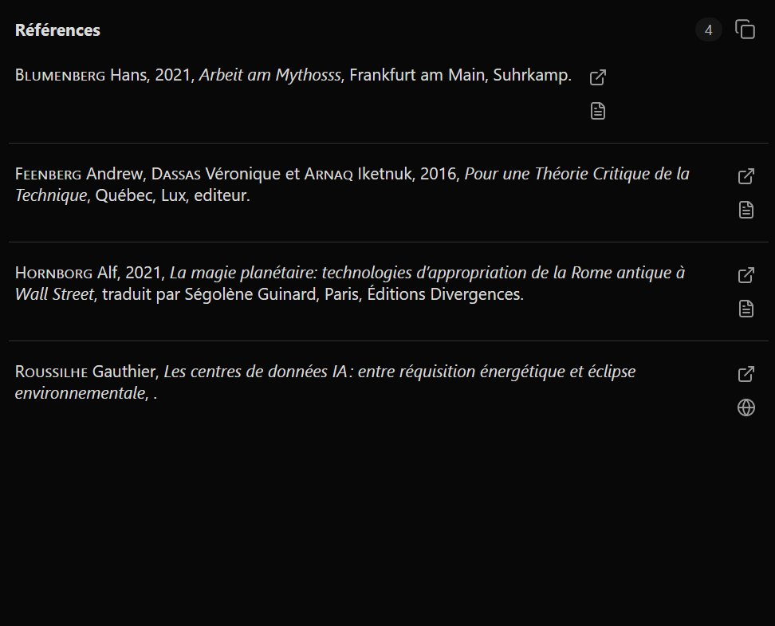

<table>
<tr>
<td></td>
<td align="left">
<h1 style="margin:0">Radiomarker</h1>

<strong>Marcadores REAPER · podcast 4 pistas · exportación Obsidian</strong> Scripts Lua · instalador Windows · interfaz HTML

</td>
</tr>
</table>

  
Desarrollado por <a href="https://atelier.atechnologie.fr/">l'Atelier</a> — fabricación de libros y herramientas de investigación (EHESS)

🇫🇷 <a href="README.md">Français</a> ·
🇬🇧 <a href="README.en.md">English</a> ·
🇩🇪 <a href="README.de.md">Deutsch</a> ·
🇪🇸 <a href="README.es.md"><b>Español</b></a>

---

## 📸 Vista previa

| Interfaz HTML | Marcadores |
| :---: | :---: |
|  |  |

---

## 📖 Acerca del proyecto

Radiomarker añade botones HTML para colocar marcadores REAPER por interlocutor (**P1 a P4**) y tipo (**Error**, **Cita**, **Nota**, **Nombrar**), con exportación Markdown / audio hacia **Obsidian**.

---

## ⬇️ Instalación Windows (recomendada)

1. Compilar el instalador: abrir [`installer/RadiomarkerSetup.iss`](installer/RadiomarkerSetup.iss) en **Inno Setup 6**, luego *Build → Compile*. El ejecutable sale en `dist/RadiomarkerSetup.exe`.
2. Ejecutar `RadiomarkerSetup.exe`. Indicar la **carpeta de recursos REAPER**:
   - instalación clásica: normalmente `%APPDATA%\REAPER` (sugerido por defecto) ;
   - **REAPER portable**: la carpeta de datos de esa copia (donde REAPER lee/escribe `Scripts`).
3. El instalador copia los archivos en `Scripts\Radiomarker\` y fusiona `Scripts\__startup.lua` sin sobrescribir un archivo existente: añade una sola vez un bloque marcado `Radiomarker bootstrap (installer)`.
4. En el siguiente arranque de REAPER, los scripts se registran y el HTML se sincroniza **sin ventanas de éxito** (modo silencioso). En caso de error, los mensajes se muestran igual.
5. Abrir `podcast_4pistes.html` desde la interfaz web de REAPER (opción: acceso directo en el Escritorio si se marcó en la instalación).

---

## 🛠️ Instalación manual (sin instalador)

Colocar la carpeta del proyecto (o al menos `reaper_lua_markers/` y `podcast_4pistes.html`) manteniendo la estructura: un directorio padre que contenga `reaper_lua_markers\` y `podcast_4pistes.html` al mismo nivel (como en este repositorio).

Luego en REAPER:

1. Abrir la lista de acciones (`?`).
2. Ejecutar `ReaScript: Run/edit ReaScript (EEL2 or Lua)..` y elegir:
   - primero `reaper_lua_markers/install_markers_actions.lua` ;
   - después `reaper_lua_markers/sync_html_command_map.lua`.
3. Para el arranque automático como con el instalador, añadir en `Scripts\__startup.lua` la llamada descrita en el instalador (bloque `Radiomarker bootstrap (installer)`), o ejecutar una vez `reaper_lua_markers/radiomarker_bootstrap.lua` desde un script de arranque existente.

---

## 📝 Exportación Obsidian (MP3 + Markdown)

**Importante:** el `.md` **no** se crea solo con *File → Render*. Orden: **primero** *File → Render* (hacia `D:\…` o REAPER Media), **después** la acción **`export_markers_obsidian`** (no vuelve a lanzar el render).

1. Configurar **File → Project render settings** (MP3 o WAV, mixdown, carpeta de salida).
2. Nombrar el proyecto REAPER como se quiera mostrar en la nota (`audio_start_time` retoma ese nombre; si el nombre es `YYYY-MM-DD HH:MM:SS`, los enlaces incluyen también la marca de tiempo absoluta `\[HH:MM:SS]`).
3. Colocar los marcadores con la interfaz Radiomarker.
4. **File → Render** → producir el MP3/WAV.
5. Lanzar **`export_markers_obsidian`**: el script lee la ruta **RENDER_FILE** de REAPER (incluso si el archivo está en `REAPER Media\…\proyecto.mp3\proyecto.mp3`) y escribe el `.md` **en la misma carpeta** que el audio.
6. Si no se detecta nada, un cuadro pide **elegir el archivo de audio** a mano.
7. Archivos producidos:
   - `{NombreDelProyecto}.mp3` (o el nombre elegido al render) — audio mezclado ;
   - mismo nombre con extensión `.md` — frontmatter, embed `![[…mp3]]`, enlaces `[[…mp3#t=sec|MM:SS]]` por marcador (clicables en Obsidian).
8. Colocar el audio y el `.md` en la **misma carpeta** del vault Obsidian.

Los marcadores Radiomarker (NOMBRAR, ERROR, CITA, etc.) se convierten en una línea de enlace cada uno; la etiqueta es el texto tras el último `_` en el nombre del marcador (ej. `Interlocutor1_inicio` → `inicio`). Una línea vacía sigue a cada enlace para añadir notas en Obsidian.

---

## 📁 Archivos útiles

- `podcast_4pistes.html` — interfaz web de botones
- `reaper_lua_markers/install_markers_actions.lua` — registra los scripts en la lista de acciones
- `reaper_lua_markers/sync_html_command_map.lua` — inyecta los `Command ID` en el HTML
- `reaper_lua_markers/radiomarker_bootstrap.lua` — encadena install + sync en modo silencioso (arranque REAPER)
- `reaper_lua_markers/export_markers_obsidian.lua` — exportación MP3 + Markdown Obsidian
- `reaper_lua_markers/radiomarker_export.lua` — biblioteca compartida para la exportación
- `installer/RadiomarkerSetup.iss` — script Inno Setup → `dist/RadiomarkerSetup.exe`

---

## 🔗 Recursos

| | |
| --- | --- |
| 🌐 **l'Atelier** | [atelier.atechnologie.fr](https://atelier.atechnologie.fr/) |
| 📦 **Repositorio** | [github.com/Atelier-Recherche/radiomarker](https://github.com/Atelier-Recherche/radiomarker) |

---

<a href="README.md">🇫🇷 Français</a> · <a href="README.en.md">🇬🇧 English</a> · <a href="README.de.md">🇩🇪 Deutsch</a> · 🇪🇸 Español · Radiomarker — <a href="https://atelier.atechnologie.fr/">l'Atelier</a>

