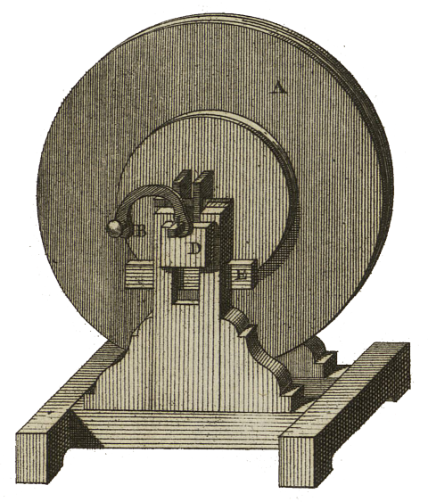
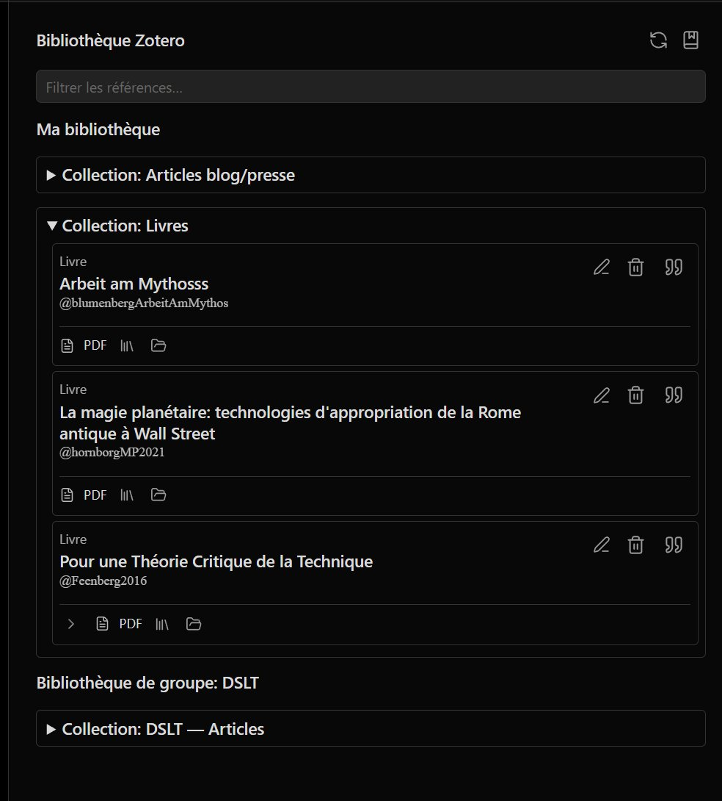
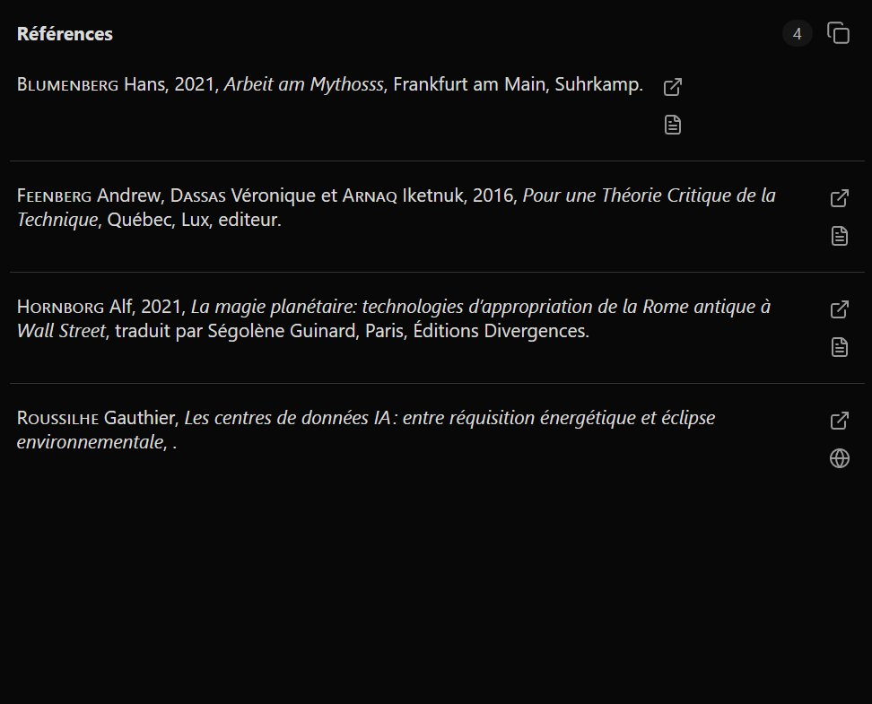

<table>
<tr>
<td></td>
<td align="left">
<h1 style="margin:0">Radiomarker</h1>

<strong>Marqueurs REAPER · podcast 4 pistes · export Obsidian</strong> Scripts Lua · installeur Windows · interface HTML

</td>
</tr>
</table>

  
Développé par <a href="https://atelier.atechnologie.fr/">l'Atelier</a> — fabrication de livres et outils de recherche (EHESS)

🇫🇷 <a href="README.md"><b>Français</b></a> ·
🇬🇧 <a href="README.en.md">English</a> ·
🇩🇪 <a href="README.de.md">Deutsch</a> ·
🇪🇸 <a href="README.es.md">Español</a>

---

## 📸 Aperçu

| Interface HTML | Marqueurs |
| :---: | :---: |
|  |  |

---

## 📖 À propos

Radiomarker ajoute des boutons HTML pour poser des marqueurs REAPER par intervenant (**P1 à P4**) et type (**Erreur**, **Citation**, **Note**, **Nommer**), avec export Markdown / audio vers **Obsidian**.

---

## ⬇️ Installation Windows (recommandée)

1. Compiler l’installeur : ouvrir [`installer/RadiomarkerSetup.iss`](installer/RadiomarkerSetup.iss) dans **Inno Setup 6**, puis *Build → Compile*. L’exécutable sort dans `dist/RadiomarkerSetup.exe`.
2. Lancer `RadiomarkerSetup.exe`. Indiquer le **dossier ressources REAPER** :
   - installation classique : en général `%APPDATA%\REAPER` (proposé par défaut) ;
   - **REAPER portable** : le dossier de données de cette copie (celui où REAPER lit/écrit `Scripts`).
3. L’installeur copie les fichiers sous `Scripts\Radiomarker\` et fusionne `Scripts\__startup.lua` sans écraser un fichier existant : il ajoute un bloc marqué `Radiomarker bootstrap (installer)` une seule fois.
4. Au prochain lancement de REAPER, les scripts sont enregistrés et le HTML est synchronisé **sans fenêtres de réussite** (mode silencieux). En cas d’erreur, les messages s’affichent toujours.
5. Ouvrir `podcast_4pistes.html` depuis l’interface web REAPER (option : raccourci Bureau si coché à l’installation).

---

## 🛠️ Installation manuelle (sans installeur)

Placer le dossier du projet (ou au minimum `reaper_lua_markers/` et `podcast_4pistes.html`) de façon à garder la structure : un répertoire parent contenant `reaper_lua_markers\` et `podcast_4pistes.html` au même niveau (comme dans ce dépôt).

Ensuite dans REAPER :

1. Ouvrir la liste des actions (`?`).
2. Lancer `ReaScript: Exécuter/éditer ReaScript (EEL2 ou Lua)..` et choisir :
   - d’abord `reaper_lua_markers/install_markers_actions.lua` ;
   - ensuite `reaper_lua_markers/sync_html_command_map.lua`.
3. Pour le démarrage automatique comme avec l’installeur, ajouter dans `Scripts\__startup.lua` l’appel décrit dans l’installeur (bloc `Radiomarker bootstrap (installer)`), ou lancer une fois `reaper_lua_markers/radiomarker_bootstrap.lua` depuis un script de démarrage existant.

---

## 📝 Export Obsidian (MP3 + Markdown)

**Important :** le `.md` n’est **pas** créé par *File → Render* seul. Ordre : **d’abord** *File → Render* (vers `D:\…` ou REAPER Media), **ensuite** l’action **`export_markers_obsidian`** (elle ne relance pas le render).

1. Configurer **File → Project render settings** (MP3 ou WAV, mixdown, dossier de sortie).
2. Nommer le projet REAPER comme on veut l’afficher dans la note (`audio_start_time` reprend ce nom ; si le nom est `YYYY-MM-DD HH:MM:SS`, les liens incluent aussi l’horodatage absolu `\[HH:MM:SS]`).
3. Poser les marqueurs avec l’interface Radiomarker.
4. **File → Render** → produire le MP3/WAV.
5. Lancer **`export_markers_obsidian`** : le script lit le chemin **RENDER_FILE** de REAPER (même si le fichier est dans `REAPER Media\…\projet.mp3\projet.mp3`) et écrit le `.md` **dans le même dossier** que l’audio.
6. Si rien n’est détecté, une boîte demande de **choisir le fichier audio** à la main.
7. Fichiers produits :
   - `{NomDuProjet}.mp3` (ou le nom choisi au render) — audio fusionné ;
   - même nom avec extension `.md` — frontmatter, embed `![[…mp3]]`, liens `[[…mp3#t=sec|MM:SS]]` par marqueur (cliquables dans Obsidian).
8. Placer l’audio et le `.md` dans le **même dossier** du vault Obsidian.

Les marqueurs Radiomarker (NOMMER, ERREUR, CITATION, etc.) deviennent une ligne de lien chacun ; le libellé est le texte après le dernier `_` dans le nom du marqueur (ex. `Intervenant1_debut` → `debut`). Une ligne vide suit chaque lien pour y ajouter des notes dans Obsidian.

---

## 📁 Fichiers utiles

- `podcast_4pistes.html` — interface web des boutons
- `reaper_lua_markers/install_markers_actions.lua` — enregistre les scripts dans la liste d’actions
- `reaper_lua_markers/sync_html_command_map.lua` — injecte les `Command ID` dans le HTML
- `reaper_lua_markers/radiomarker_bootstrap.lua` — enchaîne install + sync en mode silencieux (démarrage REAPER)
- `reaper_lua_markers/export_markers_obsidian.lua` — export MP3 + Markdown Obsidian
- `reaper_lua_markers/radiomarker_export.lua` — bibliothèque partagée pour l’export
- `installer/RadiomarkerSetup.iss` — script Inno Setup → `dist/RadiomarkerSetup.exe`

---

## 🔗 Ressources

| | |
| --- | --- |
| 🌐 **l'Atelier** | [atelier.atechnologie.fr](https://atelier.atechnologie.fr/) |
| 📦 **Dépôt** | [github.com/Atelier-Recherche/radiomarker](https://github.com/Atelier-Recherche/radiomarker) |

---

🇫🇷 <a href="README.md">Français</a> · <a href="README.en.md">🇬🇧 English</a> · <a href="README.de.md">🇩🇪 Deutsch</a> · <a href="README.es.md">🇪🇸 Español</a> · Radiomarker — <a href="https://atelier.atechnologie.fr/">l'Atelier</a>

